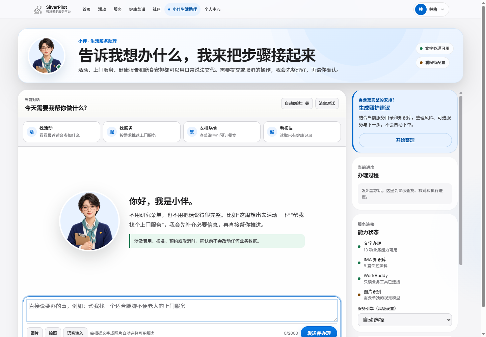

# SilverPilot

[](https://github.com/LeiQingliang/silverpilot/actions/workflows/ci.yml)
[](https://github.com/LeiQingliang/silverpilot/actions/workflows/codeql.yml)
[](LICENSE)
[](workbuddy/README.md)

[](runtime-versions.json)
[](SourceCode/cecsmsServe-springboot/pom.xml)
[](SourceCode/cecsmsui-vue/package.json)
[](SourceCode/cecsmsui-vue/package.json)
[](database/README.md)
[](redis/README.md)
[](compose.yaml)

**SilverPilot 是面向社区养老服务的开源业务 Agent 平台。** 居民可以用自然语言查活动、约上门服务、订餐和看本人的体检报告。模型调用业务工具，后端校验身份和参数。报名、预约或取消须由居民确认后执行。

**[观看演示（13 分 32 秒）](https://leiqingliang.github.io/silverpilot/)** · [在线体验与账号](#在线体验) · [本地启动](#快速开始) · [系统架构](#系统架构) · [开发与验证](#开发与验证)

<p align="center">
  <a href="docs/screenshots/agent-workspace-20260821-0202.png"></a>
</p>

## 演示视频

https://github.com/user-attachments/assets/65eecf9c-077e-4c51-855c-c71717d7780a

[04:13 查询活动](https://leiqingliang.github.io/silverpilot/media/silverpilot-demo.mp4#t=253) · [06:35 查看照护建议](https://leiqingliang.github.io/silverpilot/media/silverpilot-demo.mp4#t=395) · [07:25 核对服务订单](https://leiqingliang.github.io/silverpilot/media/silverpilot-demo.mp4#t=445) · [11:25 检查模型与知识来源](https://leiqingliang.github.io/silverpilot/media/silverpilot-demo.mp4#t=685)

GitHub 内嵌播放器提供流畅版。需要看清字段或确认卡时，可打开 2560 × 1528 原画，将默认的最高可用倍速切回 1×。[高清与倍速播放](https://leiqingliang.github.io/silverpilot/)

## 界面快照

<details>
<summary>查看管理端运行记录、运营总览和手机端服务订单</summary>

| 小伴运营中心 | 运营数据总览 |
| --- | --- |
| [](docs/screenshots/agent-operations-20260821-0202.png) | [](docs/screenshots/operations-dashboard-20260821-0202.png) |

| 手机端服务目录 | 手机端服务订单 |
| --- | --- |
| [](docs/screenshots/mobile-services-20260821-0202.png) | [](docs/screenshots/mobile-service-orders-20260821-0202.png) |

截图取自 2026-08-21 的本地 Docker 演示环境，使用合成数据。[全部原图](docs/screenshots/)

</details>

## 在线体验

使用下列共享账号和登录页验证码即可体验。**公网共享账号均为只读**，体验时请使用虚构信息。[打开在线应用](https://silverpilot.up.railway.app/login)

- **居民**　用户名 `linge`，密码 `123456`。进入「小伴生活助理」点击「找活动」，在「办理过程」查看查询轨迹，再到「活动」页核对结果。
- **管理员**　用户名 `admin`，密码 `123456`。进入「智能服务运营 → 小伴运营中心」，在「最近运行记录」查看状态、耗时和工具调用次数。

公网 AI 配额在访客之间共享。遇到 `429` 时可稍后重试。要验证确认写入和订单结果，请使用本地环境。

## 快速开始

以下命令在 **Windows PowerShell 5.1 或 PowerShell 7** 中执行。准备 Git，并启动带 Compose 的 Docker Desktop。全容器模式使用镜像内的 Java、Node.js、MySQL 和 Redis，首次构建需要联网。

```powershell
git clone https://github.com/LeiQingliang/silverpilot.git
cd silverpilot
.\start-docker.cmd
```

当控制台出现 `[READY]`，打开其输出的登录地址，默认是 [127.0.0.1:8082/login](http://127.0.0.1:8082/login)。新建数据库卷可用上面的居民账号登录。启动器会生成包含本机凭据的 `.env.docker`。已有数据卷沿用已有账号和密码。

**确认前后端连通。** 下列两个请求经过同一个前端端口，分别检查 Nginx 和它代理的 Spring Boot 服务。若修改过前端端口，请替换 `8082`。

```powershell
$app = 'http://127.0.0.1:8082'
(Invoke-RestMethod "$app/healthz").Trim()           # ok
(Invoke-RestMethod "$app/api/actuator/health").status  # UP
```

关闭启动窗口后，容器继续在后台运行。要停止项目并保留数据库、Redis 和上传文件的命名卷，在仓库根目录执行 `.\stop-project.cmd`。

### 模型配置

选择与你要验证的功能对应的配置。编辑本机 `.env.docker` 后，重新运行 `.\start-docker.cmd` 载入更改。[环境变量模板](.env.docker.example) · [模型与多模态接入说明](docs/LLM_PROVIDER_INTEGRATION.md)

- **浏览业务页面**可以直接使用初始配置，查询活动、服务和订单均无需模型密钥。
- **验证只读工具**时设置 `SILVERPILOT_AI_MOCK_ENABLED=true`，然后运行[只读契约评测](#agent-契约评测)，检查工具调用和知识引用。
- **体验真实对话与预约**时填写 `SILVERPILOT_DEEPSEEK_API_KEY`，将 `SILVERPILOT_DEEPSEEK_MODEL` 设为账号可用的模型 ID。豆包图片理解需要单独设置 `SILVERPILOT_DOUBAO_API_KEY` 和 `SILVERPILOT_DOUBAO_MODEL`。LongCat 文本适配的配置及联调记录见接入说明。

### 验证一笔上门服务预约

在本地使用真实文本模型和居民账号 `linge`。先查看「服务订单」，以便对照操作前后的记录。

1. **查目录。** 在「小伴生活助理」输入「有哪些可以预约的上门服务？」，从实际返回的目录选择一项服务。
2. **核对计划。** 提供今天或之后的日期（`YYYY-MM-DD`）和虚构地址，例如「演示小区三号楼」。确认卡列出服务、日期和地址摘要。此时动作状态为 `PENDING`。
3. **核对结果。** 点击「确认并执行」。成功后点击右上角用户名，进入「服务订单」核对新增记录。另发一笔请求并选择「暂不执行」，可验证放弃待确认预约时没有新增订单。

## 系统架构

浏览器统一请求同源 `/api`。在 Docker 模式下由 Nginx 转发，在 IDE 开发模式下由 Vite 转发。两者都会去掉 `/api` 前缀，例如浏览器发送的 `POST /api/chat` 对应后端 `POST /chat`。

| 组件 | 职责与数据边界 |
| --- | --- |
| Vue 工作台 | 发送登录用户的请求，展示回复、工具轨迹、来源引用和确认卡。[前端模块](SourceCode/cecsmsui-vue/) |
| Spring Boot / MyBatis-Plus | 从登录 JWT 识别用户，校验角色、资源归属和业务参数。Web Agent 有 8 个只读工具、5 个待确认写工具。[工具定义](SourceCode/cecsmsServe-springboot/src/main/java/com/cecsmsserve/util/Tools.java) |
| MySQL / Redis | MySQL 保存目录、订单、运行及动作记录。Redis 用于验证码、共享限流及 AI 配额。[数据与端口配置](compose.yaml) |
| 知识库 | 对已审核、处于复核有效期内的 Markdown 按词项检索，返回 `[KB:来源]`。照护建议校验可用服务 ID，供服务导航和就医沟通参考。[知识治理](knowledge-base/README.md) |
| WorkBuddy MCP | 使用独立密钥提供 6 个非个人只读工具，用于查目录、检索已审核知识和读取匿名聚合指标。[接入指南](docs/WORKBUDDY_IMA_QUICKSTART.md) |

### Agent 如何办理业务

运行状态描述一次对话的处理进度，动作状态描述一次具体写操作。以预约为例，可在登录后打开浏览器开发者工具的「网络」面板，按顺序核对以下请求。路径均以浏览器侧为准。

1. `GET /api/chat/status` 返回模型配置状态和 `knowledge.ready`。从工作台判断模型、知识源是否可用时，先看这个响应。
2. `POST /api/chat` 返回 `reply`、`trace` 和 `run`。准备好写操作时，`run.status` 为 `WAITING_CONFIRMATION`，`pendingAction.status` 为 `PENDING`，此时尚未生成订单。
3. 居民确认后，前端向 `/api/chat/actions/{token}/confirm` 发送 POST。后端校验本人身份、令牌、有效期和动作状态。核对响应中的 `success` 和 `action.status`，成功终态为 `SUCCEEDED`。即使 HTTP 返回 200，仍应读取业务结果。
4. 如果确认后网络中断，先用 `GET /api/chat/actions?limit=10` 查看本人动作记录，再核对服务订单。同一确认令牌已成功时，重复确认会返回已有结果。放弃待确认动作使用 `POST /api/chat/actions/{token}/cancel`，取消已有订单则是另一项需要确认的业务操作。

完整读写时序、运行审计及模型路由见[系统架构设计](docs/ARCHITECTURE.md)与 [AI Harness](docs/AI_HARNESS.md)。

## 开发与验证

### 严格 IDEA + VSCode 本地开发

需要断点调试时，后端和前端分别由 IDEA、VSCode 启动，默认前端端口为 `8081`。切换到该模式会停止并移除本项目全容器模式下的前端、后端和 MySQL 容器，命名卷保留。[运行模式与切换](docs/DEPLOYMENT.md)

1. 准备本机 MySQL（`127.0.0.1:3306`），用种子 SQL 初始化 `a_old`，设置 `CECSMS_LOCAL_DB_PASSWORD` 或 `CECSMS_DB_PASSWORD`。在仓库根目录执行 `.\start-local.cmd` 准备 Docker Redis 和本机配置。[数据库初始化](database/README.md)
2. 用 IDEA 打开 `SourceCode/cecsmsServe-springboot`，选择 JDK 25，启动 `com.cecsmsserve.CecsmsServeApplication`。[后端开发指南](SourceCode/cecsmsServe-springboot/README.md)
3. 确认后端健康接口返回 `UP` 后，用 VSCode 打开 `SourceCode/cecsmsui-vue`，执行 `npm ci` 和 `npm run dev`，访问[本地开发登录页](http://127.0.0.1:8081/login)。[前端开发指南](SourceCode/cecsmsui-vue/README.md)

### 复现检查

- **已启动的 Docker 栈。** 在仓库根目录运行 `.\scripts\verify-running-stack.ps1`。它读取本机环境配置，检查四个服务的健康状态、同源代理和媒体资源，全部通过时输出 `[PASS] SilverPilot runtime verification completed successfully`。
- **提交前工程检查。** 在完整 Git 工作目录中准备 JDK 25、Node.js 24.19.0、npm 12.0.2 和 Python 3.12，然后从仓库根目录运行下列命令。[运行时清单](runtime-versions.json) · [CI 工作流](.github/workflows/ci.yml)

```powershell
Push-Location .\SourceCode\cecsmsui-vue
npm ci
Pop-Location
.\scripts\verify-publication-safety.ps1
.\scripts\verify-project.ps1
```

### Agent 契约评测

先启动本地 Docker 栈，按[模型配置](#模型配置)选择相应模式，再从仓库根目录执行所需的一条命令。

```powershell
# 显式 Mock：前 6 条只读用例，无需付费模型
.\scripts\run-agent-evaluation.ps1 -Provider mock -MaxCases 6 -EnvFile .\.env.docker

# DeepSeek：全部 16 条工程契约，使用真实模型额度
.\scripts\run-agent-evaluation.ps1 -Provider deepseek -MaxCases 0 -EnvFile .\.env.docker
```

评测脚本默认直连后端 `127.0.0.1:8083`。例如后端改用 `18083` 时，在命令末尾追加 `-BaseUrl http://127.0.0.1:18083`。需要保存 JSON 报告可加 `-ReportPath .\.qa-artifacts\agent-eval.json`。

2026-08-20 的 DeepSeek 报告记录了 **16/16** 项工程契约通过，其中两条写操作用例到达待确认状态。当前评测脚本检查后会取消待办。要验证确认后是否生成订单，请按[预约验收步骤](#验证一笔上门服务预约)核对。[评测集与判定规则](evaluation/README.md) · [原始 JSON 报告](docs/agent-evaluation-live.json) · [整栈验证](docs/VALIDATION_REPORT.md)

### 常见问题

- **启动时报端口占用。** 默认宿主端口为前端 `8082`、后端 `8083`、MySQL `3307`、Redis `6380`，均绑定回环地址。调整 `.env.docker` 对应的 `SILVERPILOT_*_PORT` 后重启。
- **登录页可打开，但业务请求失败。** 先检查前端端口的 `/api/actuator/health`。再运行 `.\scripts\docker-dev.ps1 status` 定位未就绪服务，用 `.\scripts\docker-dev.ps1 logs` 查看启动错误。
- **活动查询正常，但助手没有模型或知识来源。** 从 `/api/chat/status` 分别核对 `providers` 和 `knowledge`。更改密钥或模型 ID 后重启。知识源缺失时，检查文档的 `status`、`reviewed_at` 和 `next_review_at`。[知识复核流程](knowledge-base/README.md)

## 维护与发布

| 任务 | 工程入口 |
| --- | --- |
| 部署与排障 | [本地部署](docs/DEPLOYMENT.md) · [Railway 部署](deploy/railway/README.md) · [公网入口与配额](deploy/railway/EDGE_PROTECTION.md) |
| 修改模型、知识或运营流程 | [Provider 接入](docs/LLM_PROVIDER_INTEGRATION.md) · [运营指标与复测](docs/AI_OPERATIONS_WORKFLOW.md) · [AI 运营扩展验证](docs/AI_OPERATIONS_VALIDATION.md) · [CatPaw / LongCat](catpaw/README.md) |
| 准备贡献或发布 | [贡献指南](CONTRIBUTING.md) · [行为准则](CODE_OF_CONDUCT.md) · [版本策略](docs/VERSION_POLICY.md) · [发布与回滚](docs/RELEASE_PROCESS.md) · [变更记录](CHANGELOG.md) |
| 获取支持或报告漏洞 | [使用支持](SUPPORT.md) · [安全策略](SECURITY.md) · [私密报告漏洞](https://github.com/LeiQingliang/silverpilot/security/advisories/new) |
| 下载演示素材 | [高清 MP4（约 296 MB）](https://github.com/LeiQingliang/silverpilot/releases/download/demo-video-2026-11-04/silverpilot-demo-original.mp4) · [归档与校验文件](https://github.com/LeiQingliang/silverpilot/releases/tag/demo-video-2026-11-04) |

## 软件工程毕业设计论文

**《面向社区养老服务的可验证 AI Agent 平台设计与实现》** 以上门服务预约为例，说明如何从服务目录查询、居民确认一直追踪到最终订单。论文记录了作者使用多种 AI 编程工具独立开发 SilverPilot 的实践，也收录了项目运行截图和社区服务站试点方案。

PDF 与可编辑 Word 为同一版定稿，共 56 页。[阅读 PDF 定稿](docs/thesis/silverpilot-thesis.pdf) · [下载可编辑 Word 定稿](docs/thesis/silverpilot-thesis.docx?raw=true) · [查看论文对应源码快照 `768674c3`](https://github.com/LeiQingliang/silverpilot/tree/768674c3f86eaae16983a35b60bae71fee8e2faa)

| 如果要核对 | 建议阅读 |
| --- | --- |
| 工程测了什么，知识检索如何比较 | 第 7 章。28 题检索对照实验比较知识来源的排序和无匹配时的返回结果。 |
| 如何复现部署、接口联调与验收 | 第 8 章和附录 C。 |
| 如何从原始数据复算实验结果 | 附录 E，内含原始数据及复算脚本。 |

### 项目答辩 PPT

《SilverPilot 智慧养老业务 Agent 平台》用 5 页回答「上门服务预约什么时候才算下单」，随后展示业务工具与后端校验、养老知识引用和照护建议校验。最后一页列出已完成的工程验证，以及仍需到社区服务站试点测量的办理效率。[下载答辩幻灯片（PPTX，5 页）](docs/thesis/silverpilot-defense.pptx?raw=true)

## 求职作品与项目证据

以下材料面向 **AI 产品运营、AI 产品经理、客户经理／AI 销售** 三类岗位，围绕产品决策、技术理解、商业化方案和 AI 工具使用组织证据。

| 阅读目标 | 材料 |
| --- | --- |
| 快速了解业务问题、关键产品决策和岗位对应能力 | [项目展示概览](portfolio/career-2026-11-11/SilverPilot-README求职展示补充.md) |
| 按岗位查看简历条目、作品集摘要、面试问答及对应出处 | [三岗位求职证据包](portfolio/career-2026-11-11/SilverPilot-三岗位求职证据包.md) |
| 记录用户研究、试点验收、个人／团队／AI 分工，或准备三分钟演示 | [验证与贡献记录模板](portfolio/career-2026-11-11/SilverPilot-验证与贡献记录模板.md) |

材料核查于 **2026-11-11**。学校项目期（2026 年 1 月至 8 月）的个人职责按简历自述，11 月的仓库迭代单独记录。模板中的用户试用、机构试点及业务收益均待实际验证。

## 许可证与引用

本项目采用 [Apache License 2.0](LICENSE)。引用项目时可使用仓库的[引用元数据](CITATION.cff)。
