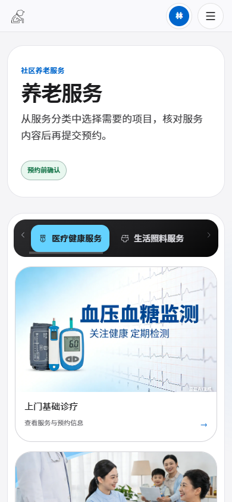

# SilverPilot · 智慧养老业务 Agent 平台

SilverPilot 是面向社区养老服务的开源应用。居民可以请「小伴」查活动、约上门服务、订餐或查看本人的体检报告。以预约为例，小伴从服务目录找出可选项目，居民核对日期和地址并确认后，后端才创建订单。管理员可在运营中心追踪办理结果和失败原因。

**[观看完整演示（13 分 32 秒）](https://leiqingliang.github.io/silverpilot/)** · **[打开在线体验](https://silverpilot.up.railway.app/login)** · [演示账号](#在线体验) · [本地启动](#快速开始)

<p align="center">
  <a href="docs/screenshots/agent-workspace-20260821-0202.png"></a>
</p>

## 演示视频

https://github.com/user-attachments/assets/65eecf9c-077e-4c51-855c-c71717d7780a

**跳到操作画面**　[04:13 查询活动](https://leiqingliang.github.io/silverpilot/media/silverpilot-demo.mp4#t=253) · [06:35 查看照护建议](https://leiqingliang.github.io/silverpilot/media/silverpilot-demo.mp4#t=395) · [07:25 核对服务订单](https://leiqingliang.github.io/silverpilot/media/silverpilot-demo.mp4#t=445) · [11:25 查看模型与知识来源](https://leiqingliang.github.io/silverpilot/media/silverpilot-demo.mp4#t=685)

上方播放器为流畅版。高清播放页提供 2560 × 1528 原画，默认使用浏览器支持的最高倍速，可切回 1× 观看操作细节。[高清与倍速播放](https://leiqingliang.github.io/silverpilot/)

## 在线体验

打开登录页，输入共享账号、密码和页面验证码。演示使用合成数据，请用虚构的示例信息体验。[公网登录](https://silverpilot.up.railway.app/login)

| 想体验什么 | 用户名 | 密码 | 登录后从哪里开始 |
| --- | --- | --- | --- |
| 居民如何找活动 | `linge` | `123456` | 打开「小伴生活助理」，点击「找活动」，在「办理过程」查看查询轨迹，再到「活动」页核对结果。 |
| 管理员如何跟踪办理情况 | `admin` | `123456` | 打开「智能服务运营 → 小伴运营中心」，在「最近运行记录」查看状态、耗时和工具调用次数。 |

两个公网账号均为只读，适合浏览和查询。若要确认预约并核对新订单，请按下方步骤在本地运行。公网 AI 额度由同一账号的访客共享，遇到 `429` 可稍后再试。

## 快速开始

### Windows 一键启动

准备 Git、Windows PowerShell 5.1 或 PowerShell 7，并启动带 Compose 的 Docker Desktop。该模式在容器中运行前端、后端、MySQL 和 Redis。首次构建需要联网获取镜像和依赖。

```powershell
git clone https://github.com/LeiQingliang/silverpilot.git
cd silverpilot
.\start-docker.cmd
```

启动器会生成本地配置 `.env.docker`。浏览器打开登录页后，用上表账号登录。没有模型密钥也可以浏览活动、服务和订单。要让小伴调用真实模型，请先完成[模型配置](#模型配置)。

| 检查项 | 默认地址或命令 | 预期结果 |
| --- | --- | --- |
| 打开应用 | <http://127.0.0.1:8082/login> | 显示登录页和验证码 |
| 检查后端 | <http://127.0.0.1:8083/actuator/health> | JSON 中的 `status` 为 `UP` |
| 检查容器 | `.\scripts\docker-dev.ps1 status` | MySQL、Redis、后端、前端均为 `healthy` |

关闭启动窗口后服务继续在后台运行。在仓库根目录执行 `.\stop-project.cmd` 可正常停止，数据库、Redis 和上传文件的命名卷会保留。

### 模型配置

编辑首次启动生成的 `.env.docker`，保存后重新运行 `.\start-docker.cmd`。密钥仅放在本机被 Git 忽略的配置中。全部变量见[环境配置模板](.env.docker.example)。

| 需要的能力 | 要配置的内容 |
| --- | --- |
| 文本问答与真实业务工具 | 填写 `SILVERPILOT_DEEPSEEK_API_KEY`，并将 `SILVERPILOT_DEEPSEEK_MODEL` 设为账号可用的模型 ID。 |
| 图片理解 | 为豆包配置 `SILVERPILOT_DOUBAO_API_KEY` 和 `SILVERPILOT_DOUBAO_MODEL`（模型或推理接入点 ID）。 |
| 无密钥测试只读工具 | 显式设置 `SILVERPILOT_AI_MOCK_ENABLED=true`，按下方命令运行 6 条只读契约。 |

```powershell
.\scripts\run-agent-evaluation.ps1 -Provider mock -MaxCases 6 -EnvFile .\.env.docker
```

LongCat 文本适配器也有独立配置。真实账号联调进度、各模型支持的输入和错误处理见 [Provider 接入说明](docs/LLM_PROVIDER_INTEGRATION.md)。

### 验证一笔上门服务预约

在本地 Docker 环境启用真实文本模型后，用普通账号 `linge` 打开「小伴生活助理」。

1. **查服务。** 输入「有哪些可以预约的上门服务？」从返回的目录选一项，记下服务名称。
2. **核对预约。** 告诉小伴要预约哪项服务，提供今天或之后的日期（`YYYY-MM-DD`）和虚构地址。确认卡会显示服务名称、日期和脱敏地址。此时动作处于 `PENDING`。
3. **查订单。** 点击「确认并执行」。办理成功后点击右上角用户名，选择「服务订单」，核对刚才的服务和日期。若想同时验证放弃预约，可另发一笔请求并点击「暂不执行」，再检查订单列表。

### 常见问题

| 现象 | 处理 |
| --- | --- |
| 启动时报端口冲突 | 默认宿主端口为前端 `8082`、后端 `8083`、MySQL `3307`、Redis `6380`。在 `.env.docker` 中调整冲突组件的端口，重新启动后使用新地址。 |
| 页面或容器未就绪 | 在仓库根目录运行 `.\scripts\docker-dev.ps1 status`，再用 `.\scripts\docker-dev.ps1 logs` 查看对应服务的启动错误。 |
| 能浏览业务，但小伴无法回答 | 查看工作台的模型状态，核对 `.env.docker` 中的密钥和模型 ID，重启 Docker 栈。只想验证只读工具时可启用 Mock。 |
| 活动查询正常，知识问答却找不到来源 | 活动来自数据库，知识问答检索已审核且在有效期内的文档。检查知识条目的 `status` 和 `next_review_at`。如已过期，按[知识治理流程](knowledge-base/README.md)复核后再运行知识引用用例。 |

卷管理、数据库初始化和分模式排障见[部署说明](docs/DEPLOYMENT.md)。公网部署的只读账号、访问限制和模型预算见 [Railway 部署指南](deploy/railway/README.md)。

## Agent 如何办理业务

Vue 工作台收集需求并展示工具结果。Spring Boot 根据登录身份读取 MySQL、检查数据归属和业务条件，模型通过后端提供的工具参与办理。

| 能力 | 具体行为 |
| --- | --- |
| 查询业务 | 8 个只读工具覆盖活动、服务目录、本人订单、体检报告、菜谱及养老知识。个人数据按当前登录用户读取。 |
| 执行写操作 | 活动报名、预约或取消服务、预订或取消助餐共 5 类。工具先创建待确认动作，后端校验确认人、有效期和动作状态，业务执行成功后才返回办理结果。 |
| 引用知识 | 从审核通过且在复核有效期内的 Markdown 检索词项，回答中可查看 `[KB:…]` 来源。照护建议还会核对可选服务 ID，用于服务导航和就医沟通准备。 |
| 跟踪问题 | 管理员可查看运行状态、工具调用次数、动作结果与耗时，登记失败案例，关联修复记录并复测。 |
| 对接外部助手 | WorkBuddy MCP 提供 6 个非个人、只读工具，用于查询目录、审核知识和匿名聚合指标。 |

读写时序、工具权限和知识检索设计见[系统架构](docs/ARCHITECTURE.md)与 [AI Harness](docs/AI_HARNESS.md)。健康相关功能仅供信息整理与服务导航，临床判断由专业人员负责。

## 界面快照

| 管理端 · 小伴运行 | 管理端 · 运营数据总览 |
| --- | --- |
| [](docs/screenshots/agent-operations-20260821-0202.png) | [](docs/screenshots/operations-dashboard-20260821-0202.png) |

<details>
<summary>查看手机端服务目录与订单</summary>

| 居民端 · 服务目录 | 居民端 · 服务订单 |
| --- | --- |
| [](docs/screenshots/mobile-services-20260821-0202.png) | [](docs/screenshots/mobile-service-orders-20260821-0202.png) |

</details>

截图采自 2026-08-21 的本地 Docker 演示环境。社区首页、登录页及原尺寸截图见[截图目录](docs/screenshots/)。

## 开发与验证

后端使用 Java 25、Spring Boot 4 和 MyBatis-Plus，前端使用 Vue 3 和 Vite，数据层使用 MySQL 和 Redis。精确版本见[运行时版本清单](runtime-versions.json)。

### 严格 IDEA + VSCode 本地开发

1. 准备本机 MySQL（`127.0.0.1:3306`）并初始化 `a_old`，设置 `CECSMS_LOCAL_DB_PASSWORD` 或 `CECSMS_DB_PASSWORD`。在仓库根目录执行 `.\start-local.cmd`，由脚本准备 Docker Redis 和配置。[数据库初始化](database/README.md)
2. 用 IntelliJ IDEA 打开 `SourceCode/cecsmsServe-springboot`，选择 JDK 25，运行 `com.cecsmsserve.CecsmsServeApplication`。先检查后端健康接口返回 `UP`。[后端开发指南](SourceCode/cecsmsServe-springboot/README.md)
3. 用 VSCode 打开 `SourceCode/cecsmsui-vue`，按版本清单准备 Node.js 24 和 npm 12。在该目录依次运行 `npm ci`、`npm run dev`，访问 <http://127.0.0.1:8081/login>。[前端开发指南](SourceCode/cecsmsui-vue/README.md)

### 复现检查

| 想验证什么 | 从哪里开始 |
| --- | --- |
| 本地 Docker 是否完整可用 | 启动后从仓库根目录运行 `.\scripts\verify-running-stack.ps1`，检查服务健康、前端代理和媒体资源。 |
| 后端、前端与知识库是否通过工程检查 | 准备 JDK、Node.js、npm、Python，并在前端目录执行 `npm ci`。回到仓库根目录运行 `.\scripts\verify-project.ps1`。 |
| 真实 Agent 的工具选择、权限与确认行为 | 配置 DeepSeek 并启动本地栈后，运行 `.\scripts\run-agent-evaluation.ps1 -Provider deepseek -MaxCases 0 -EnvFile .\.env.docker`。完整集含 16 例，会使用模型额度。[评测集与判定规则](evaluation/README.md) |

2026-08-20 的 DeepSeek 记录中，16 项工程契约全部通过。其中写操作用例检查待确认状态后取消。要验证确认后的订单，请按[上门服务预约步骤](#验证一笔上门服务预约)操作。[原始评测报告](docs/agent-evaluation-live.json) · [整栈验证记录](docs/VALIDATION_REPORT.md) · [后续 AI 运营扩展验证](docs/AI_OPERATIONS_VALIDATION.md)

## 维护与发布

| 阅读目的 | 入口 |
| --- | --- |
| 维护知识、接入外部助手 | [知识审核与有效期](knowledge-base/README.md) · [WorkBuddy / ima 接入](docs/WORKBUDDY_IMA_QUICKSTART.md) · [CatPaw / LongCat 实践](catpaw/README.md) |
| 复盘运营问题 | [指标口径、问题登记与复测](docs/AI_OPERATIONS_WORKFLOW.md) |
| 部署、加固与发布 | [Railway 入口规则](deploy/railway/EDGE_PROTECTION.md) · [安全设计](docs/SECURITY.md) · [发布与回滚](docs/RELEASE_PROCESS.md) · [变更记录](CHANGELOG.md) |
| 下载演示原片 | [高清 MP4（约 296 MB）](https://github.com/LeiQingliang/silverpilot/releases/download/demo-video-2026-11-04/silverpilot-demo-original.mp4) · [视频归档与校验文件](https://github.com/LeiQingliang/silverpilot/releases/tag/demo-video-2026-11-04) |

代码与文档贡献请参阅[贡献指南](CONTRIBUTING.md)和[行为准则](CODE_OF_CONDUCT.md)。使用问题见[支持渠道](SUPPORT.md)，安全问题请通过[私密报告渠道](SECURITY.md)提交。

## 软件工程毕业设计论文

**《面向社区养老服务的可验证 AI Agent 平台设计与实现》** 以上门服务预约为例，说明如何从服务目录查询、居民确认一直追踪到最终订单。论文记录了作者使用多种 AI 编程工具独立开发 SilverPilot 的实践，也收录了项目运行截图和社区服务站试点方案。

PDF 与可编辑 Word 为同一版定稿，共 56 页。[阅读 PDF 定稿](docs/thesis/silverpilot-thesis.pdf) · [下载可编辑 Word 定稿](docs/thesis/silverpilot-thesis.docx?raw=true) · [查看论文对应源码快照 `768674c3`](https://github.com/LeiQingliang/silverpilot/tree/768674c3f86eaae16983a35b60bae71fee8e2faa)

| 如果要核对 | 建议阅读 |
| --- | --- |
| 工程测了什么，知识检索如何比较 | 第 7 章。28 题检索对照实验比较知识来源的排序和无匹配时的返回结果。 |
| 如何复现部署、接口联调与验收 | 第 8 章和附录 C。 |
| 如何从原始数据复算实验结果 | 附录 E，内含原始数据及复算脚本。 |

### 项目答辩 PPT

《SilverPilot 智慧养老业务 Agent 平台》用 5 页回答「上门服务预约什么时候才算下单」，随后展示业务工具与后端校验、养老知识引用和照护建议校验。最后一页列出已完成的工程验证，以及仍需到社区服务站试点测量的办理效率。[下载答辩幻灯片（PPTX，5 页）](docs/thesis/silverpilot-defense.pptx?raw=true)

## 求职作品与项目证据

以下材料面向 **AI 产品运营、AI 产品经理、客户经理／AI 销售** 三类岗位，围绕产品决策、技术理解、商业化方案和 AI 工具使用组织证据。

| 阅读目标 | 材料 |
| --- | --- |
| 快速了解业务问题、关键产品决策和岗位对应能力 | [项目展示概览](portfolio/career-2026-11-11/SilverPilot-README求职展示补充.md) |
| 按岗位查看简历条目、作品集摘要、面试问答及对应出处 | [三岗位求职证据包](portfolio/career-2026-11-11/SilverPilot-三岗位求职证据包.md) |
| 记录用户研究、试点验收、个人／团队／AI 分工，或准备三分钟演示 | [验证与贡献记录模板](portfolio/career-2026-11-11/SilverPilot-验证与贡献记录模板.md) |

材料核查于 **2026-11-11**。学校项目期（2026 年 1 月至 8 月）的个人职责按简历自述，11 月的仓库迭代单独记录。模板中的用户试用、机构试点及业务收益均待实际验证。

## 许可证与引用

本项目采用 [Apache License 2.0](LICENSE)。引用项目时可使用仓库的[引用元数据](CITATION.cff)。
